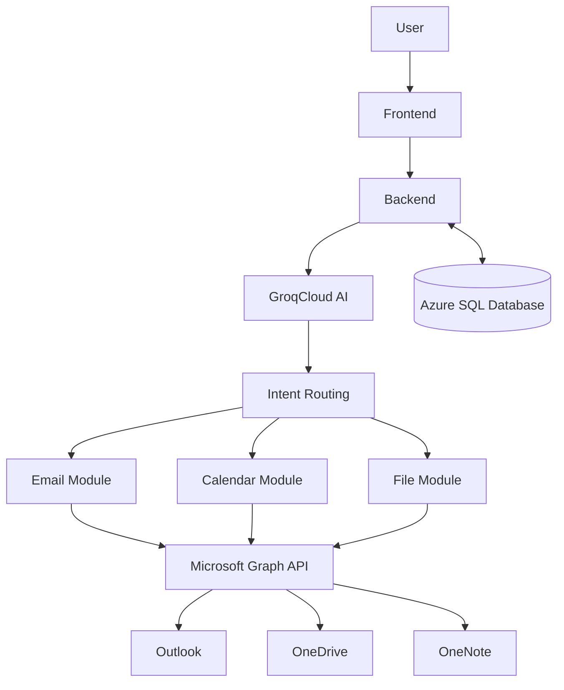

### 1.0 Overview 
The Kainos Smart Assistant is a desktop-based productivity application that integrates artificial intelligence with Microsoft services to assist users in managing tasks, time, and workflows. The system combines natural language interaction with backend automation to provide a unified interface for accessing emails, calendar events, files, and user-generated productivity data.
The primary goal of the system is to reduce context switching between different tools by centralising functionality into a single application. This is achieved through the integration of a large language model (LLM), Microsoft Graph API, and a cloud-based database.

### 2.0 System Architecture 
The system follows a layered architecture, consisting of five main layers:
Frontend (Electron-based UI)
Backend (Flask server + Node integration)
AI Processing Layer (GroqCloud API)
External Services Layer (Microsoft Graph API)
Data Layer (Azure SQL Database)

### 3.0 Component design 
## 3.1 Frontend
The frontend has the following responsibilities for rendering the UI for the user, with electron.js and css
Responsibilities include:
Handling and rendering data
Communicating with the Azure Database
Calculating graph data for representations
Communicating user queries to the GroqCloud API

## 3.2 Backend  
The backend acts as the central controller of the system. It is implemented using Python (Flask) to handle API communication and JavaScript (Node.js) for application logic.
Responsibilities include:
Handling requests from the frontend
Communicating with the AI model
Routing requests based on intent
Managing database operations
Interfacing with Microsoft Graph API
## 3.3 Ai processing layer 
The system uses the GroqCloud API, which provides access to a LLaMA-based large language model.
The AI is responsible for:
Interpreting natural language input
Classifying user intent
Extracting parameters from queries
Generating natural language responses
The system uses prompt engineering to ensure structured outputs, enabling reliable parsing and routing.
## 3.4 external services 
Microsoft Graph API is used to integrate external services, including:

Outlook (emails)
Calendar (events)
OneDrive (files)
OneNote (notes)

Each service is accessed through dedicated backend modules that convert user requests into API calls.

Authentication is handled via OAuth 2.0 with Microsoft Entra ID, ensuring secure access to user data.
### 4.0 Integration design 
## 4.1 frontend 
The UI pages will communicate through many different files for api handling due to the safety requirements of front end elements and how they are easily subjected to malicious interactions such as hacking.
The front end will directly connect to the preloader.js file which defines all of the APIs for the front end javaScript to use by making the functions global. This is then linked to the ipcHandler.js file that directs the APIs to the actual functions as well as the parameters which can then connect the actual queries that are defined for the database access in db.js.
Another integrated feature is the frontend using simple queries that connect to the GroqCloud API through the server.py file. This file is at the core of connecting the whole of the back end AI features to the front end AI features. As well as the workflowsExecutor.js files that acts like the ipcHandler and preloader however for the AI aspects of the application.
## 4.2 backend 
The backend acts as the central coordination layer between the frontend, AI service, Microsoft Graph API, and Azure SQL database. It is mainly implemented using Python with a Flask server, alongside Node/Electron backend files that support IPC communication and database access.

For AI-related requests, the frontend sends the user’s query to the Flask server. The backend then forwards the natural language input to the GroqCloud API, where the LLaMA model classifies the user’s intent and extracts any relevant parameters. The backend receives this structured response and uses routing logic to decide which module should handle the request.

Each backend module is responsible for a specific area of functionality. Email requests are routed to the email handler, calendar requests to the calendar handler, file requests to the file handler, and OneNote requests to the OneNote handler. These handlers then call the relevant Microsoft Graph API functions to retrieve, create, or update user data.

Authentication is handled through Microsoft Entra ID and OAuth 2.0. Once the user logs in and grants permission, access tokens are used by the backend to securely communicate with Microsoft Graph API. This allows the system to access Outlook, Calendar, OneDrive, and OneNote data only after user consent.

The backend also connects to the Azure SQL database to manage application data such as workflows, settings, activity logs, and insights. Database functions are separated from frontend code, meaning the frontend requests an action while the backend handles the actual database query.

### 5. Design decision 
Use of Azure Database over AWS
Inclusive of the Microsoft family similar to the Microsoft Graph API
Cheaper as we are using the student version
Easier to integrate as we know the code base of Microsoft applications
Supervisor recommendation

Use of GroqCloud over OpenAI
Chosen due to:
No subscription cost
Ease of integration
Supervisor recommendation

### 6. Limitations 
AI relies on prompt-based classification (not fully deterministic)
Requires user to manually track activity
Limited automation compared to initial proposal
Dependent on external APIs and internet connectivity

### 7. Future improvements 
Add multi-user and collaboration features
Expand integration with Microsoft services
Improve AI accuracy and consistency
Introduce automated behaviour tracking (with user consent)
Enhance performance and error handling

### 8. Conclusion 
The Kainos Smart Assistant demonstrates a modular and scalable design that successfully integrates AI with cloud-based productivity tools. By combining natural language processing with structured backend logic, the system provides a functional assistant capable of supporting real user tasks. While there are limitations, the design provides a strong foundation for future development into a more advanced and intelligent system

